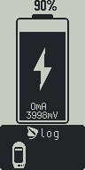

# Device screen captures

Store reusable Leaf screen captures here for the user manual, website, release
notes, and other documentation. Keep review-specific galleries, test evidence,
and capture generators under [`docs/ui-reviews`](../../ui-reviews/).

Prefer native-resolution PNGs for still screens and GIFs for short animations.
Keep the original 96 x 192 pixels when available; use nearest-neighbor scaling
when enlarging them in documentation. Put captures in a named feature folder and
record their source, firmware/context, dimensions, and any limitations here or in
a README alongside the images. Add new captures rather than replacing an image
whose behavior belongs to an older firmware version.

## Charging and Leaf Log

| Asset | Details |
|---|---|
| `charging/leaf-log-sequence.gif` | Native 96 x 192 pixels; 53 frames; 500 ms per frame |
| Source | Existing untracked GIF from the charging-dialog revamp review, preserved byte for byte on October 29, 2026 |
| Context | Charging / Leaf Log upload UI; original file dated October 22, 2026 |
| Related evidence | [Charging-dialog review](../../ui-reviews/charging-dialog-revamp/review.html) and [verification notes](../../ui-reviews/charging-dialog-revamp/verification.txt) |

The original GIF does not identify an exact firmware commit or whether it was
captured on hardware or in the simulator. Treat it as a historical documentation
asset and check the current UI before using it in a version-specific manual.
