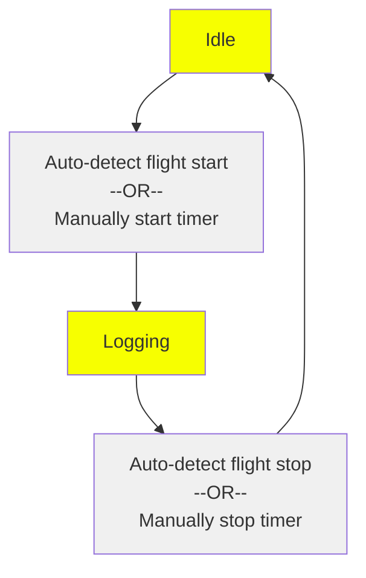

# Leaf Logging Functions

<!-- Adopted from https://docs.google.com/document/d/1Rp0IslOAHZlb1cdwXtGMdCtgvGe01PvQ_RnXXEvWxjQ/edit?usp=sharing -->

There are various terms currently used in “Leaf-Land” that have overlap or confusing definitions, such as:

> Flight, Timer, Log, Logging, LogBook, Track, TrackLog, Records, Flight Summary, etc…

This document aims to clarify the design intent, and be a helpful guide in implementing feature improvements (and code clarification) on Leaf.

## Main Operational States of Leaf

Leaf has two main operational states:
* Idle (not tracking a Flight), and
* Logging (actively tracking a Flight).

Transition between these states can be auto-detected (via motion, speed, altitude change, etc), or manually switched (by starting/stopping the flight timer).



### Automatic flight start and launch diagnostics

Auto Start evaluates a rolling three-second history while idle. All input channels
must be valid throughout their required window; the left endpoint is interpolated
when samples do not land exactly three seconds apart. Speed and signed vertical
rate use time-weighted averages. Altitude and position use net endpoint departure,
not accumulated absolute movement.

Any one of these independent paths can start the timer:

| Path | Conditions over the same three-second window | Extra confirmation |
| --- | --- | --- |
| Forward | Mean fresh GPS speed ≥2.2352 m/s (5 mph) **and** net GPS displacement ≥5 m | 1 second |
| Vertical | Net pressure-altitude change magnitude ≥3 m **and** mean vertical-rate magnitude **>0.5 m/s**, agreeing on direction | 1 second |
| Blended | Corroborated forward and vertical evidence satisfy the nonlinear boundary below | 1 second |

For the blended path:

```text
S = min(mean_speed_mps / 2.2352, net_GPS_displacement_m / 5)
U = min(abs(net_pressure_altitude_change_m) / 3, abs(mean_vertical_rate_mps) / 0.5)
qualify when S >= 0.7, U >= 0.5, and S + U*U >= 1
```

Pressure-altitude change and mean vertical rate must have the same nonzero sign
before either vertical path receives credit. Ascent and descent behave identically.
Average signed vertical-rate readings first, then take the magnitude; alternating
climb/sink readings must not accumulate as positive motion. The blended floors
require both ≥3.5 mph and ≥3.5 m GPS displacement, plus ≥1.5 m pressure departure
and ≥0.25 m/s agreeing mean vertical rate. Evidence may saturate at one without
changing these decisions.

All three candidates must remain qualified for one further elapsed second. A low
individual speed reading changes its rolling average rather than clearing the
history. A failed candidate resets that path's confirmation only; changing vertical
direction also restarts vertical and blended confirmation. The vertical path does
not require GPS, and the forward path does not require barometric data.

Constants live in `src/vario/logging/flight_auto_start.h`.
A first sample establishes time, and a gap over two seconds resets the detector
instead of counting unseen movement. Storage is bounded (32 samples, sufficient
for the normal 1 Hz check and 250 ms regression sampling). Toggling Auto Start,
showing a flight summary, and starting/stopping a flight reset the detector.
These are detector timings; sensor acquisition, filtering and polling add delay.
A larger departure bubble has not been finalized here.

Pressure departure uses the fresh **unadjusted pressure altitude** in centimeters
converted to meters. It is not GPS altitude, QNH-adjusted altitude, or an integral
of the IMU velocity estimate. Speed and position use the existing usable/fresh GPS
checks; vario uses the valid fixed one-second average, independently of display
smoothing. Losing a required channel invalidates that path's window until fresh
history replaces it. Track recording still waits for GPS, synced time, a ready
barometer, and a writable SD card after the timer starts.

The temporary thirty-second pre-launch diagnostic ring and its STARTDATA/STARTALT/
STARTPOS/STARTPATH records have been removed from firmware. Only the short operational
motion window used by `FlightAutoStart` remains; launch thresholds, shared evidence and
confirmation behavior are unchanged. Delayed GPS acquisition retains just timer-start
uptime, cause and the accepted launch-path mask:

```text
LXLVSTART V=3 CAUSE=AUTO T_MS=42000 J=1
```

`T_MS` is timer-start uptime, even if the track opens later. Causes are AUTO or MANUAL.
`J` is the confirmed automatic path mask (1=forward, 2=vertical, 4=blended); manual starts
use zero. Older START V1/V2 records are historical formats, with their original units
and configurations. No launch-history cache is retained just for logging.

At normal close, an end-cause record precedes the G checksum:

```text
LXLVEND V=1 CAUSE=AUTO T_MS=123000
```

End causes are AUTO, MANUAL, POWER_OFF, or LOW_BATTERY. Abrupt power loss cannot
write an end record. Flights with track saving disabled, or stopped before an IGC
opens, have no IGC diagnostics. The normal writer includes all diagnostics in its
checksum.

Run `make -C sim test-flight-start-window test-flight-auto-start test-thermal-lifecycle`
in the usual container for model boundaries, sign reflection, GPS/barometer
dropouts, history, real fused-sensor launches and IGC lifecycle checks.

### Automatic flight stop

Auto Stop requires 15 consecutive qualifying checks at the normal one-second
logging cadence. Each check requires pressure altitude strictly within 2 m of the
retained altitude anchor, valid acceleration within 0.2 g of 1 g, and GPS speed
below 3 mph when a usable fix exists. Without a usable GPS fix, speed is bypassed
so a stationary unit packed indoors can stop logging and later shut down through
system Auto Off. A usable fix with stale speed does not qualify.

A failed check resets the count and moves the altitude anchor to the current
pressure altitude. This is an anchor-departure test, not a full rolling altitude
range. The warning dialog and sound appear at check seven, leaving an eight-second
countdown before stopping at check fifteen. The pilot can dismiss the warning to
reset confirmation; another quiet period can start a new countdown afterward.

### What Happens During Each State

The table below outlines what actions do/don't happen during each state:

<table>
  <thead>
    <tr>
      <th>Idle State</th>
      <th>Logging State</th>
    </tr>
  </thead>
  <tbody>
    <tr>
      <td><ul>
        <li>Vario Beeping is muted (if QuietMode is on)</li>
        <li>Timer is stopped at 0:00</li>
        <li>No active Flight Object</li>
        <li>No Tracking</li>
        <li>Leaf is detecting if a new Flight has started (if AutoStart is enabled)</li>
      </ul></td>
      <td><ul>
        <li>Vario Beeping is unmuted</li>
        <li>Timer is running</li>
        <li>Flight object is active</li>
        <li>Flight stats are being recorded(duration, min/max alt, etc)</li>
        <li>Logbook contains one additional LogbookEntry than before (may be a preliminary or constantly-updating Entry as the flight continues)</li>
        <li>GPSTrack file is being written (if user has enabled Tracking and GPS is available)</li>
        <li>Leaf is detecting if the current Flight has ended (if AutoStop is enabled)</li>
      </ul></td>
    </tr>
  </tbody>
</table>


## Logging Terms and Definitions

For each Logging Session (i.e., a Flight), Leaf will save a __LogbookEntry__ inside the __Logbook__.

### LogbookEntry

A LogbookEntry includes:
* Flight Summary Info
  * Flight number/index (perhaps, though maybe not visible to the user?)
  * Date, Time
  * Duration
  * Max/min values (alt, climbrate, speed, etc)
* GPSTrack File Link/Reference (if chosen to save)
  * A link to this separate GPSTrack File will be one of the fields in the LogbookEntry.  The GPSTrack File will be a separate IGC file (perhaps additional formats supported in the future)

__NOTE ON GPS REQUIREMENT:__ While the GPSTrack file strictly requires a GPS fix, the LogbookEntry itself does not strictly need GPS data.  However, certain GPS information (date, time, launch location, etc) make the LogbookEntry more informative and robust.  While we anticipate usually having a GPS fix when logging, the Logbook (and each Entry) should function to a minimum level without GPS.

### Logbook

The __Logbook__ includes the collection of all __LogbookEntries__, as well as possible summations/totals of the entries, such as:
* Overall Date Range (earliest entry and latest entry)
* Total Flight Time
* Total Number of Flights
* Etc 

## Logbook User Experience

Leaf users will have a few ways of interacting with the logbook
* Viewing LogbookEntries on the Leaf display (scrolling through each previous flight in [reverse] chronological order)
  * Perhaps the option to delete an entry (typically for when it was made in error; for example accidentally starting the timer)

* Exporting the Logbook into a user-friendly format like JSON or CSV for viewing on computer in a spreadsheet, etc.

* (perhaps) Web page served by Leaf

* (perhaps) uploading a LogbookEntry over wifi to an online repository (for examples: leonardo or XCcontest)


### Current Logbook Status
Presently (8/18/2025) Leaf will only show a brief flight summary after a flight has ended (timer stopped).  Once that summary page is dismissed, it is no longer accessible.  Additionally, a GPSTrack file can be saved.  

There are no other logbook functions currently supported.  The following content is an attempt to sketch out what such additional features could look like.

### Logbook Menu
The "Log/Timer" Menu should likely be changed to "Logging" or similar.  This can incorporate both Logbook settings as well as accessing the Logbook of previously-logged flights.

The revised Logbook menu might look like this:

<pre>
___/LOGGING\______
--Settings--------
Auto Start    ☐
Auto Stop     ☐
Save GPSTrack ☐
Format     IGC
------------------
Previous Flights➡
Export Logbook  ➡
------------------
Back            ⏎
</pre>

The __Settings__ would work as they do currently.

__"Previous Flights"__ (or perhaps "View Logbook") would take you into a minimalistic viewer on the Leaf display, where you would essentially see the "Flight Summary" page of the most recently logged flight (including date, time, etc so you could tell which flight that was).  Scrolling left/right would take you between logged flights.  
* Possibly, the first thing you see when selecting "previous flights" might be an overall logbook summary, with total flights, total flight time, etc etc. 

__"Export Logbook"__ would take the JSON logbook stored inside Leaf (or more likely on the SD card) and export a CSV file that would be easily human-readable & editable in a spreadsheet application.

### Flight Summary Page

The (while-viewing-logbook) Flight Summary Page might look something like this.  Perhaps there's an "erase flight" option to clean up the logbook (in case you accidentally started the timer and/or saved a really short non-flight flight) 

<pre>
____/LOGBOOK\_____
Flight      X of Y 
11:45am Mo/Dy/Year
Duration:  01h:55m
MaxAlt:     5,590'
AboveLaunch:1,590'
MaxClimb: 1,230fpm
------------------
Erase Flight    ➡
------------------
⇦Prev|Back⏎|Next⇨
</pre>

# G-load tracking and compact flight diagnostics

The temporary V1–V3 g-load snapshots, interval ranges, pending/discarded ranges and
eleven-record per-second dump are no longer emitted. Their raw/filtered/discarded
diagnostic range accumulators are also removed. The flight-extrema buckets remain:
they implement the intentional 15-second launch exclusion and 30–60-second landing
holdback, not diagnostic history.

G-load filtering, both IMU chip paths, the live User-page value and saved logbook extrema
are unchanged. The ten-sample average is approximately 0.5 seconds at 20 Hz; it is not
a fixed-duration resampler. ICM20948 uses ±4 g per axis and LSM6DSV ±8 g per axis, with
the accepted resultant bound accounting for all three axes. Extrema remain unavailable
until the first history commits, roughly 75 seconds after confirmed entry. Unavailable
values are JSON null and display as dashes.

Entry still uses the same confirmed motion-window evidence as Auto Start. Automatic
starts hand their accepted mask directly to g-load tracking. Manual starts collect fresh
shared evidence even with Auto Start disabled, while waiting for GPS or with track saving
disabled. Landing still needs twenty valid quiet checks: speed ≤8 mph AND absolute
filtered climb ≤50 cm/s. Either positive activity indication vetoes landing; unavailable
inputs clear the quiet counter. Landing clears launch evidence before a relaunch.
These checks remain distinct from timer Auto Stop and do not eliminate its ground false positives.

## Event records

Each new IGC contains one configuration record:

```text
LXLVFDCFG V=1 WRITE_MS=100 GAP_MS=500 REPORT_MS=30000
```

During a timer session, fixed-size RAM counters collect events without I/O. At most one
record per event kind is emitted per 30-second reporting interval, only when an event
occurred. Normal flight seconds add no diagnostic lines. A final drain before the G
checksum preserves events in a short/partial interval. After a track opens, reporting
continues through GPS outages; the event timestamps remain their original uptime even
if reporting was delayed waiting for GPS.

```text
LXLVFDTIME T=150000 UTC=231500
LXLVFD K=WRITE N=2 T=123000 DT=930 R=0
LXLVFD K=KALMAN N=1 T=124100 DT=1700 R=0
```

Each nonempty report starts with one `FDTIME` uptime/UTC anchor, so original event times
can be mapped to the flight track even after delayed reporting or a UTC midnight crossing.
There are at most seven event lines plus that one anchor per report; no anchor is written
for an empty report. All lines fit within 76 characters including LXLV, excluding CRLF. `N` is the number
of events since the last report, saturating at 65535. `DT` is the greatest observed
duration/gap in milliseconds; `T` is that event's original timestamp, with the latest
event winning a tie. For zero-duration resets, T is the latest reset. `R` ORs reason
bits from all events of that kind in the interval, not necessarily just the worst event.
T wraps with the 32-bit uptime clock. WRITE timestamps mark the start of the write;
gap timestamps mark the arriving observation after the gap.

| K | Meaning |
| --- | --- |
| `WRITE` | Actual IGC-backed Print write call took at least 100 ms, including automatic filesystem buffer writes. The measurement includes waiting in the storage stack; it does not establish which storage layer caused the delay. |
| `IMU` | Explicit `IMU::wake` reset. R: 1=unspecified, 2=sleep, 4=wake, 8=sensor reset message, 16=source change, 32=missing LSM acceleration, 64=invalid gravity projection, 128=bias calibration. DT=0. |
| `GRAVITY` | Legacy gravity estimate recovery reset. DT=0. |
| `KALMAN` | Existing >1.5-second observation-gap guard actually reinitialized the estimator. DT is the measured Kalman update interval, not an acceleration-only gap. Normal first initialization is not a reset event. |
| `FIFO` | ICM FIFO reset. R: 1=incomplete packet, 2=backlog beyond the eight-packet drain limit. DT=0. LSM discontinuities reach IMU through its reset message. |
| `MOTION` | Accepted g-load samples were more than 500 ms apart, causing averaging warm-up. N counts those gaps; DT/T preserve the worst accepted-sample interval. |
| `PRESSURE` | Fresh accepted pressure observations in the ready state were more than 500 ms apart. |

A slow diagnostic write only creates a pending event for the next reporting interval;
it cannot recursively produce more writes in the same report. The final drain is bounded
to one snapshot as well; writes of that snapshot, the G record, and file close cannot
report their own latency in an already finalized IGC. File-open/close, logbook JSON,
optional developer logs and other SD users are outside WRITE's measurement.
Events outside a timer session are ignored, and pending counters clear at start/stop.
Flights with track saving off, or stopped before an IGC opens, have no IGC event output.

The counters and reduced traffic aid diagnosis; they do not make synchronous SD writes
nonblocking or guarantee sensor deadlines. A simulator can verify reporting limits and
recovery after injected delays, but physical SD latency still needs a device/card comparison.

Run `make -C sim test-g-load test-flight-auto-start test-vario-continuity` for the
tracker, compact event limits, measured output, both instrument paths, lifecycle and
Kalman gap checks. The standalone tracker/event tests also run in
`.github/workflows/g-load.yaml`. The existing `g-load-diagnostics.json` sensor scenario
remains useful for injected outages; `sim/tests/check_g_load_igc.py` now checks compact
records, removal of old dumps and the closed file's checksum. Old field-data parsers
remain applicable to historical verbose recordings only.
