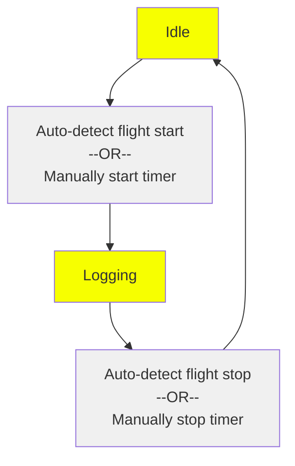

# Leaf Logging Functions

<!-- Adopted from https://docs.google.com/document/d/1Rp0IslOAHZlb1cdwXtGMdCtgvGe01PvQ_RnXXEvWxjQ/edit?usp=sharing -->

There are various terms currently used in “Leaf-Land” that have overlap or confusing definitions, such as:

> Flight, Timer, Log, Logging, LogBook, Track, TrackLog, Records, Flight Summary, etc…

This document aims to clarify the design intent, and be a helpful guide in implementing feature improvements (and code clarification) on Leaf.

## Main Operational States of Leaf

Leaf has two main operational states:
* Idle (not tracking a Flight), and
* Logging (actively tracking a Flight).

Transition between these states can be auto-detected (via motion, speed, altitude change, etc), or manually switched (by starting/stopping the flight timer).



### Automatic flight start and launch diagnostics

Auto Start uses one exponentially fading motion score, sampled once per second:

```text
motion = max(speed_mph, 0) / 4.2 + max(climb_mps, 0) / 0.7
maximum_input = 1 / (1 - exp(-3 / 2.4))
target = min(motion, maximum_input)
score = target + (previous_score - target) * exp(-elapsed_seconds / 2.4)
start when score >= 1
```

The three tuning constants are in `src/vario/logging/flight_auto_start.h`: speed scale
4.2 mph, climb scale 0.7 m/s, and memory 2.4 seconds. The cap requires at least three seconds
of observations from an empty detector. Stronger signals start sooner; weaker signals reinforce
each other. Combined motion at or below one never starts a flight by itself. The original eight
launch patterns are calibration examples rather than separate rules.

With an empty detector and valid inputs sampled at 1 Hz, the regression calibration is:

| Input pattern | Detection time |
| --- | --- |
| 8 mph | 3 s |
| 6 or 7 mph for one second, then 5 mph | 5 s |
| 1.2 or 1.0 m/s climb alone | 3 s |
| 0.8 m/s climb alone | 5 s |
| 4 mph plus 0.4 m/s climb | 3 s |
| 3 mph plus 0.3 m/s climb | 5 s |

These are detector timings; sensor acquisition/filter response and polling phase can add delay.
The fused-sensor simulator regression also checks a vertical launch without GPS within ten seconds.

GPS speed must pass the existing fresh-fix/speed checks. Climb uses a fresh barometer and the
valid fixed one-second IMU/barometer average, independently of display smoothing. Invalid
channels contribute nothing; losing both resets the score. Descending adds no climb points.
A gap over two seconds resets detection instead of treating unknown time as movement.
Toggling Auto Start resets the score immediately on either edge, even between scheduled checks.
Showing a flight summary and starting/stopping a flight also reset it.
Climb alone can start the timer without GPS; track recording still waits for GPS, synced time,
a ready barometer and a writable SD card.

While idle, a fixed RAM ring retains thirty one-second samples, including with Auto Start disabled.
At timer start it freezes until the IGC file opens, so waiting for GPS cannot overwrite the
launch evidence. It includes the triggering sample and clears at flight stop. A manual start
refreshes the current second before freezing. These are diagnostic records, not backfilled
GPS fixes or flight time.

The IGC writer emits manufacturer L records after the normal header/declaration:

```text
LXLVSTART V=1 CAUSE=AUTO T_MS=42000 N=30
LXLVSTARTCFG SPEED_MPH=4.20 CLIMB_MPS=0.70 MEMORY_S=2.40 MIN_MS=3000
LXLVSTARTFIELDS DT_MS V=MPH C=M/S S=SCORE F=1:SPEED,2:CLIMB,4:ON,8:BLOCK
LXLVSTARTDATA DT_MS=-1000 V=8 C=0.1 S=0.876543 F=07
```

Start causes are `AUTO` or `MANUAL`. `T_MS` is timer-start uptime in milliseconds; `DT_MS`
is the sample offset from that moment. `V` and `C` retain signed sensor readings (`NA` if
unusable), `S` is the score after evaluation, and hexadecimal `F` contains speed-valid (1),
climb-valid (2), Auto Start enabled (4), and summary blocking (8) bits. Repeated calls in a
clock-second replace that second with the latest reading. Offsets work across millis rollover;
gaps clear stale history rather than presenting it as recent.

At normal close, an end-cause record precedes the G checksum:

```text
LXLVEND V=1 CAUSE=AUTO T_MS=123000
```

End causes are `AUTO`, `MANUAL`, `POWER_OFF`, or `LOW_BATTERY`. This labels existing
auto-stop behavior; its thresholds are unchanged. All diagnostic records use the normal IGC
writer and are included in its checksum. Abrupt power loss cannot write an end record. Flights
with track saving disabled, or stopped before an IGC file opens, have no IGC diagnostics.
These temporary records support field tuning.

Run `make -C sim test-flight-auto-start test-thermal-lifecycle` in the usual container for
calibration, invalid input, lifecycle, delayed-GPS history and IGC start/end-cause checks.

### What Happens During Each State

The table below outlines what actions do/don't happen during each state:

<table>
  <thead>
    <tr>
      <th>Idle State</th>
      <th>Logging State</th>
    </tr>
  </thead>
  <tbody>
    <tr>
      <td><ul>
        <li>Vario Beeping is muted (if QuietMode is on)</li>
        <li>Timer is stopped at 0:00</li>
        <li>No active Flight Object</li>
        <li>No Tracking</li>
        <li>Leaf is detecting if a new Flight has started (if AutoStart is enabled)</li>
      </ul></td>
      <td><ul>
        <li>Vario Beeping is unmuted</li>
        <li>Timer is running</li>
        <li>Flight object is active</li>
        <li>Flight stats are being recorded(duration, min/max alt, etc)</li>
        <li>Logbook contains one additional LogbookEntry than before (may be a preliminary or constantly-updating Entry as the flight continues)</li>
        <li>GPSTrack file is being written (if user has enabled Tracking and GPS is available)</li>
        <li>Leaf is detecting if the current Flight has ended (if AutoStop is enabled)</li>
      </ul></td>
    </tr>
  </tbody>
</table>


## Logging Terms and Definitions

For each Logging Session (i.e., a Flight), Leaf will save a __LogbookEntry__ inside the __Logbook__.

### LogbookEntry

A LogbookEntry includes:
* Flight Summary Info
  * Flight number/index (perhaps, though maybe not visible to the user?)
  * Date, Time
  * Duration
  * Max/min values (alt, climbrate, speed, etc)
* GPSTrack File Link/Reference (if chosen to save)
  * A link to this separate GPSTrack File will be one of the fields in the LogbookEntry.  The GPSTrack File will be a separate IGC file (perhaps additional formats supported in the future)

__NOTE ON GPS REQUIREMENT:__ While the GPSTrack file strictly requires a GPS fix, the LogbookEntry itself does not strictly need GPS data.  However, certain GPS information (date, time, launch location, etc) make the LogbookEntry more informative and robust.  While we anticipate usually having a GPS fix when logging, the Logbook (and each Entry) should function to a minimum level without GPS.

### Logbook

The __Logbook__ includes the collection of all __LogbookEntries__, as well as possible summations/totals of the entries, such as:
* Overall Date Range (earliest entry and latest entry)
* Total Flight Time
* Total Number of Flights
* Etc 

## Logbook User Experience

Leaf users will have a few ways of interacting with the logbook
* Viewing LogbookEntries on the Leaf display (scrolling through each previous flight in [reverse] chronological order)
  * Perhaps the option to delete an entry (typically for when it was made in error; for example accidentally starting the timer)

* Exporting the Logbook into a user-friendly format like JSON or CSV for viewing on computer in a spreadsheet, etc.

* (perhaps) Web page served by Leaf

* (perhaps) uploading a LogbookEntry over wifi to an online repository (for examples: leonardo or XCcontest)


### Current Logbook Status
Presently (8/18/2025) Leaf will only show a brief flight summary after a flight has ended (timer stopped).  Once that summary page is dismissed, it is no longer accessible.  Additionally, a GPSTrack file can be saved.  

There are no other logbook functions currently supported.  The following content is an attempt to sketch out what such additional features could look like.

### Logbook Menu
The "Log/Timer" Menu should likely be changed to "Logging" or similar.  This can incorporate both Logbook settings as well as accessing the Logbook of previously-logged flights.

The revised Logbook menu might look like this:

<pre>
___/LOGGING\______
--Settings--------
Auto Start    ☐
Auto Stop     ☐
Save GPSTrack ☐
Format     IGC
------------------
Previous Flights➡
Export Logbook  ➡
------------------
Back            ⏎
</pre>

The __Settings__ would work as they do currently.

__"Previous Flights"__ (or perhaps "View Logbook") would take you into a minimalistic viewer on the Leaf display, where you would essentially see the "Flight Summary" page of the most recently logged flight (including date, time, etc so you could tell which flight that was).  Scrolling left/right would take you between logged flights.  
* Possibly, the first thing you see when selecting "previous flights" might be an overall logbook summary, with total flights, total flight time, etc etc. 

__"Export Logbook"__ would take the JSON logbook stored inside Leaf (or more likely on the SD card) and export a CSV file that would be easily human-readable & editable in a spreadsheet application.

### Flight Summary Page

The (while-viewing-logbook) Flight Summary Page might look something like this.  Perhaps there's an "erase flight" option to clean up the logbook (in case you accidentally started the timer and/or saved a really short non-flight flight) 

<pre>
____/LOGBOOK\_____
Flight      X of Y 
11:45am Mo/Dy/Year
Duration:  01h:55m
MaxAlt:     5,590'
AboveLaunch:1,590'
MaxClimb: 1,230fpm
------------------
Erase Flight    ➡
------------------
⇦Prev|Back⏎|Next⇨
</pre>

# G-load diagnostic IGC records

The g-load experiment writes ten Leaf manufacturer comment (`LXLV`) records per logging
update, approximately once per second. State and interval ranges are bounded in memory; no
per-sample SD writes are added. Diagnostics continue through GPS outages after an IGC file opens.
The tracker also runs while waiting for the first GPS fix, or with track saving disabled.
Raw acceleration used by auto-stop and self-test is unchanged. The User page shows the fresh
filtered value, or `--.- g` during startup, missing input, and filter recovery.

V2 headers describe the actual parameters:

```text
LXLVGLCFG V=2 SLEW=3.0 AVG=10 IGNORE=15000 BUCKET=30000 LAND=20 AIR=3
LXLVGLDET SPEED=3.57632 CLIMB=50 FRESH=250 GAP=500
```

The settings describe slew in g/s, averaging samples, launch exclusion and pending bucket length
in milliseconds, and consecutive detector checks. Airborne entry requires three qualifying
checks; landing requires twenty nonqualifying checks. A check qualifies with valid speed over
8 mph OR valid absolute climb over 50 cm/s. Ground confirmation requires both measurements to
be valid and below their thresholds. Otherwise confirmation counters clear and airborne state
is retained. This is a g-load eligibility detector, separate
from the flight timer's existing auto-start/stop logic. These thresholds remain experimental.

Each group starts with `GL`; all ten records have a common `T` in device milliseconds, wrapping
at 32 bits. Preserve file order rather than sorting by timestamps. The first group may follow
earlier detector activity while waiting for GPS. One final, potentially partial interval is
written on timer stop before the IGC G checksum. It has `Z=1` and can share a `T` with the last
periodic group. Periodic groups have `Z=0`.

| Record | Fields |
| --- | --- |
| `GL` | Inputs: `S` speed (m/s), `C` climb (cm/s), `SV`/`CV` input validity, `FS` actual speed threshold result, `VC` actual climb threshold result, `L=FS OR VC`, `Z` final group. Replay flags rather than rounded `S`. |
| `GA` | Snapshots: raw `R` and filtered `F` (g), raw sample time `RT`, filter sample time `FT`, and validity `RV`/`FV`. In V2 `FV` includes window readiness AND age <=250 ms. |
| `GS` | State after the check: active `ON`, airborne `A`, ground-check count `G`, airborne-check count `H`, launch guard remaining `I` (ms on the sample clock), pending flag `P`, current bucket start `B`, committed-extrema flag `E`, transition `D`. |
| `GQ` | Interval counts: accepted raw samples `N`, filtered outputs `F`, rejected samples `RJ`, gaps over 500 ms `GP`, clipping notifications `CL`, instrument/filter resets `RS`. Counts saturate at 65535. |
| `GR` / `GF` | Raw / filtered extrema over samples delivered since the preceding diagnostic group. |
| `GC` / `GP` | Current / previous pending bucket extrema, respectively. |
| `GE` | Committed flight extrema; preserved through landing/relaunch within one timer session. |
| `GD` | Pending extrema discarded since the preceding group, including at landing and timer stop. |

`D` values are 0=no transition, 1=confirmed airborne, 2=confirmed landing, 3=insufficient detector
input, 4=tracker started, 5=tracker stopped. Counts are checks, not exact elapsed seconds.
`I` is armed only on confirmed airborne entry and starts from the next eligible filtered sample.

Every range record has `LO`/`HI` in g and the respective sample timestamps `LT`/`HT`.
Empty ranges use `LO=NA HI=NA LT=0 HT=0`. Interval ranges cover delivered motion samples
through handling and exclusion periods, not just flight-eligible samples. They preserve peaks
between the old 1 Hz snapshots, but cannot recover samples dropped by the hardware FIFO/host
polling path. `CL` counts published notifications that one or more slots clipped, not the number
of lost slots; only LSM6DSV currently supplies that notification. Zero does not prove no clipping.

For example, a knock can be visible in the interval even when the snapshot has returned to rest:

```text
LXLVGR T=123450 LO=0.800 HI=4.111 LT=122800 HT=123150
LXLVGF T=123450 LO=0.950 HI=1.120 LT=122950 HT=123300
```

Unavailable snapshots are `NA`; out-of-field snapshot numbers use `OVF`. All diagnostic lines
fit within 76 bytes, including the manufacturer prefix and excluding CRLF. V1 logs from the
earlier experiment used `LXLF`, three snapshots per update, five ground checks, and `FV` did not
guarantee freshness. Readers must use `GLCFG V` and the recorded settings to distinguish them.

The ten-sample average is approximately 0.5 seconds at the nominal 20 Hz delivered sample rate;
it is not a fixed-duration resampler. ICM-20948 uses +/-4 g per axis and LSM6DSV +/-8 g per axis;
the accepted magnitude bound accounts for all three axes. Flight extrema remain unavailable
until history is committed (roughly 15+60 seconds after confirmed entry). Unavailable values
are persisted as JSON null and displayed as dashes, rather than defaulting to 1 g.

Run `make -C sim test-g-load` inside the normal simulator container for tracker, serialization,
both real IMU instrument paths, and saved logbook/IGC checks. The standalone tracker and record
tests also run in `.github/workflows/g-load.yaml`.
For end-to-end replay, use `sim/recordings/g-load-diagnostics.json`,
`sim/scripts/g-load-diagnostics.txt`, `--accept-warning --setting AUTO_STOP=0 --setting TRACK_SAVE=1`,
and fresh SD/state directories, then run `python sim/tests/check_g_load_igc.py <generated.igc>`.
Populate the selected PlatformIO environment's dependencies at their current pinned versions;
an old cached IgcLogger can omit checksums and does not verify the current firmware behavior.
