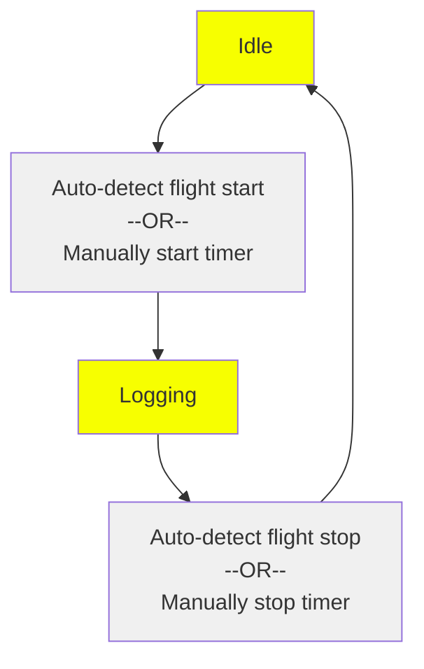

# Leaf Logging Functions

<!-- Adopted from https://docs.google.com/document/d/1Rp0IslOAHZlb1cdwXtGMdCtgvGe01PvQ_RnXXEvWxjQ/edit?usp=sharing -->

There are various terms currently used in “Leaf-Land” that have overlap or confusing definitions, such as:

> Flight, Timer, Log, Logging, LogBook, Track, TrackLog, Records, Flight Summary, etc…

This document aims to clarify the design intent, and be a helpful guide in implementing feature improvements (and code clarification) on Leaf.

## Main Operational States of Leaf

Leaf has two main operational states:
* Idle (not tracking a Flight), and
* Logging (actively tracking a Flight).

Transition between these states can be auto-detected (via motion, speed, altitude change, etc), or manually switched (by starting/stopping the flight timer).



### Automatic flight start and launch diagnostics

Auto Start evaluates a rolling three-second history while idle. All input channels
must be valid throughout their required window; the left endpoint is interpolated
when samples do not land exactly three seconds apart. Speed and signed vertical
rate use time-weighted averages. Altitude and position use net endpoint departure,
not accumulated absolute movement.

Any one of these independent paths can start the timer:

| Path | Conditions over the same three-second window | Extra confirmation |
| --- | --- | --- |
| Forward | Mean fresh GPS speed ≥2.2352 m/s (5 mph) **and** net GPS displacement ≥5 m | 1 second |
| Vertical | Net pressure-altitude change magnitude ≥3 m **and** mean vertical-rate magnitude **>0.5 m/s**, agreeing on direction | 1 second |
| Blended | Corroborated forward and vertical evidence satisfy the nonlinear boundary below | 1 second |

For the blended path:

```text
S = min(mean_speed_mps / 2.2352, net_GPS_displacement_m / 5)
U = min(abs(net_pressure_altitude_change_m) / 3, abs(mean_vertical_rate_mps) / 0.5)
qualify when S >= 0.7, U >= 0.5, and S + U*U >= 1
```

Pressure-altitude change and mean vertical rate must have the same nonzero sign
before either vertical path receives credit. Ascent and descent behave identically.
Average signed vertical-rate readings first, then take the magnitude; alternating
climb/sink readings must not accumulate as positive motion. The blended floors
require both ≥3.5 mph and ≥3.5 m GPS displacement, plus ≥1.5 m pressure departure
and ≥0.25 m/s agreeing mean vertical rate. Evidence may saturate at one without
changing these decisions.

All three candidates must remain qualified for one further elapsed second. A low
individual speed reading changes its rolling average rather than clearing the
history. A failed candidate resets that path's confirmation only; changing vertical
direction also restarts vertical and blended confirmation. The vertical path does
not require GPS, and the forward path does not require barometric data.

Constants live in `src/vario/logging/flight_auto_start.h`.
A first sample establishes time, and a gap over two seconds resets the detector
instead of counting unseen movement. Storage is bounded (32 samples, sufficient
for the normal 1 Hz check and 250 ms regression sampling). Toggling Auto Start,
showing a flight summary, and starting/stopping a flight reset the detector.
These are detector timings; sensor acquisition, filtering and polling add delay.
A larger departure bubble has not been finalized here.

Pressure departure uses the fresh **unadjusted pressure altitude** in centimeters
converted to meters. It is not GPS altitude, QNH-adjusted altitude, or an integral
of the IMU velocity estimate. Speed and position use the existing usable/fresh GPS
checks; vario uses the valid fixed one-second average, independently of display
smoothing. Losing a required channel invalidates that path's window until fresh
history replaces it. Track recording still waits for GPS, synced time, a ready
barometer, and a writable SD card after the timer starts.

While idle, a fixed RAM ring retains thirty one-second diagnostic samples,
including when Auto Start is disabled. At timer start it freezes until the IGC
opens, preserving evidence through a delayed GPS acquisition. A manual start
refreshes the current second before freezing. These are diagnostics, not backfilled
track fixes or flight time.

Version 2 manufacturer L records retain the new pressure/position history and
explicit path decisions:

```text
LXLVSTART V=2 CAUSE=AUTO T_MS=42000 N=30
LXLVSTARTCFG WINDOW_MS=3000 GAP_MS=2000 CONFIRM_MS=1000
LXLVSTARTFORWARD SPEED_MPS=2.23520 DIST_M=5.00
LXLVSTARTVERT DIST_M=3.00 CLIMB_MPS_GT=0.50 SIGN=AGREE
LXLVSTARTBLEND S_MIN=0.70 U_MIN=0.50 SCORE=S+U^2 SIGN=AGREE
LXLVSTARTUNITS V=M/S C=M/S A=M LAT/LON=DEG S=UNCONFIRMED_SCORE
LXLVSTARTFLAGS F=1:SPEED,2:CLIMB,4:ON,8:BLOCK,16:ALT,32:POS
LXLVSTARTPATHS Q=CANDIDATE T=TRIGGER 1:FORWARD,2:VERTICAL,4:BLEND
LXLVSTARTDATA DT_MS=-1000 V=2.3 C=-0.3 S=1.02 F=37
LXLVSTARTALT DT_MS=-1000 A=638.25
LXLVSTARTPOS DT_MS=-1000 LAT=37.4620000 LON=-121.8630000
LXLVSTARTPATH DT_MS=-1000 Q=01 T=00
```

Start causes remain AUTO or MANUAL. T_MS is timer-start uptime; DT_MS is the
sample offset. V is now **m/s**, whereas version 1 used mph. C remains signed
m/s. A is unadjusted pressure altitude with centimeter precision; latitude and
longitude are decimal degrees. Unusable speed/climb are NA; unavailable altitude
and position omit their corresponding records. F is a hexadecimal validity/state
mask. Q and T are hexadecimal candidate and confirmed-trigger masks. S is the
maximum unconfirmed normalized evidence across eligible paths; **S ≥1 alone is
not a start decision**. Use T for the evaluated result. Manual refreshes do not
claim an automatic path decision.

Calls within the same clock-second replace that diagnostic entry. Offsets work
across millis rollover, and gaps clear stale history. Version 1 recordings remain
historical evidence for the previous fading-score detector and must be interpreted
with their original units/configuration.

At normal close, an end-cause record precedes the G checksum:

```text
LXLVEND V=1 CAUSE=AUTO T_MS=123000
```

End causes are AUTO, MANUAL, POWER_OFF, or LOW_BATTERY. Abrupt power loss cannot
write an end record. Flights with track saving disabled, or stopped before an IGC
opens, have no IGC diagnostics. The normal writer includes all diagnostics in its
checksum.

Run `make -C sim test-flight-start-window test-flight-auto-start test-thermal-lifecycle`
in the usual container for model boundaries, sign reflection, GPS/barometer
dropouts, history, real fused-sensor launches and IGC lifecycle checks.

### Automatic flight stop

Auto Stop requires 15 consecutive qualifying checks at the normal one-second
logging cadence. Each check requires pressure altitude strictly within 2 m of the
retained altitude anchor, valid acceleration within 0.2 g of 1 g, and GPS speed
below 3 mph when a usable fix exists. Without a usable GPS fix, speed is bypassed
so a stationary unit packed indoors can stop logging and later shut down through
system Auto Off. A usable fix with stale speed does not qualify.

A failed check resets the count and moves the altitude anchor to the current
pressure altitude. This is an anchor-departure test, not a full rolling altitude
range. The warning dialog and sound appear at check seven, leaving an eight-second
countdown before stopping at check fifteen. The pilot can dismiss the warning to
reset confirmation; another quiet period can start a new countdown afterward.

### What Happens During Each State

The table below outlines what actions do/don't happen during each state:

<table>
  <thead>
    <tr>
      <th>Idle State</th>
      <th>Logging State</th>
    </tr>
  </thead>
  <tbody>
    <tr>
      <td><ul>
        <li>Vario Beeping is muted (if QuietMode is on)</li>
        <li>Timer is stopped at 0:00</li>
        <li>No active Flight Object</li>
        <li>No Tracking</li>
        <li>Leaf is detecting if a new Flight has started (if AutoStart is enabled)</li>
      </ul></td>
      <td><ul>
        <li>Vario Beeping is unmuted</li>
        <li>Timer is running</li>
        <li>Flight object is active</li>
        <li>Flight stats are being recorded(duration, min/max alt, etc)</li>
        <li>Logbook contains one additional LogbookEntry than before (may be a preliminary or constantly-updating Entry as the flight continues)</li>
        <li>GPSTrack file is being written (if user has enabled Tracking and GPS is available)</li>
        <li>Leaf is detecting if the current Flight has ended (if AutoStop is enabled)</li>
      </ul></td>
    </tr>
  </tbody>
</table>


## Logging Terms and Definitions

For each Logging Session (i.e., a Flight), Leaf will save a __LogbookEntry__ inside the __Logbook__.

### LogbookEntry

A LogbookEntry includes:
* Flight Summary Info
  * Flight number/index (perhaps, though maybe not visible to the user?)
  * Date, Time
  * Duration
  * Max/min values (alt, climbrate, speed, etc)
* GPSTrack File Link/Reference (if chosen to save)
  * A link to this separate GPSTrack File will be one of the fields in the LogbookEntry.  The GPSTrack File will be a separate IGC file (perhaps additional formats supported in the future)

__NOTE ON GPS REQUIREMENT:__ While the GPSTrack file strictly requires a GPS fix, the LogbookEntry itself does not strictly need GPS data.  However, certain GPS information (date, time, launch location, etc) make the LogbookEntry more informative and robust.  While we anticipate usually having a GPS fix when logging, the Logbook (and each Entry) should function to a minimum level without GPS.

### Logbook

The __Logbook__ includes the collection of all __LogbookEntries__, as well as possible summations/totals of the entries, such as:
* Overall Date Range (earliest entry and latest entry)
* Total Flight Time
* Total Number of Flights
* Etc 

## Logbook User Experience

Leaf users will have a few ways of interacting with the logbook
* Viewing LogbookEntries on the Leaf display (scrolling through each previous flight in [reverse] chronological order)
  * Perhaps the option to delete an entry (typically for when it was made in error; for example accidentally starting the timer)

* Exporting the Logbook into a user-friendly format like JSON or CSV for viewing on computer in a spreadsheet, etc.

* (perhaps) Web page served by Leaf

* (perhaps) uploading a LogbookEntry over wifi to an online repository (for examples: leonardo or XCcontest)


### Current Logbook Status
Presently (8/18/2025) Leaf will only show a brief flight summary after a flight has ended (timer stopped).  Once that summary page is dismissed, it is no longer accessible.  Additionally, a GPSTrack file can be saved.  

There are no other logbook functions currently supported.  The following content is an attempt to sketch out what such additional features could look like.

### Logbook Menu
The "Log/Timer" Menu should likely be changed to "Logging" or similar.  This can incorporate both Logbook settings as well as accessing the Logbook of previously-logged flights.

The revised Logbook menu might look like this:

<pre>
___/LOGGING\______
--Settings--------
Auto Start    ☐
Auto Stop     ☐
Save GPSTrack ☐
Format     IGC
------------------
Previous Flights➡
Export Logbook  ➡
------------------
Back            ⏎
</pre>

The __Settings__ would work as they do currently.

__"Previous Flights"__ (or perhaps "View Logbook") would take you into a minimalistic viewer on the Leaf display, where you would essentially see the "Flight Summary" page of the most recently logged flight (including date, time, etc so you could tell which flight that was).  Scrolling left/right would take you between logged flights.  
* Possibly, the first thing you see when selecting "previous flights" might be an overall logbook summary, with total flights, total flight time, etc etc. 

__"Export Logbook"__ would take the JSON logbook stored inside Leaf (or more likely on the SD card) and export a CSV file that would be easily human-readable & editable in a spreadsheet application.

### Flight Summary Page

The (while-viewing-logbook) Flight Summary Page might look something like this.  Perhaps there's an "erase flight" option to clean up the logbook (in case you accidentally started the timer and/or saved a really short non-flight flight) 

<pre>
____/LOGBOOK\_____
Flight      X of Y 
11:45am Mo/Dy/Year
Duration:  01h:55m
MaxAlt:     5,590'
AboveLaunch:1,590'
MaxClimb: 1,230fpm
------------------
Erase Flight    ➡
------------------
⇦Prev|Back⏎|Next⇨
</pre>

# G-load diagnostic IGC records

The g-load experiment writes eleven Leaf manufacturer comment (`LXLV`) records per logging
update, approximately once per second. State and interval ranges are bounded in memory; no
per-sample SD writes are added. Diagnostics continue through GPS outages after an IGC file opens.
The tracker also runs while waiting for the first GPS fix, or with track saving disabled.
Raw acceleration used by auto-stop and self-test is unchanged. The User page shows the fresh
filtered value, or `--.- g` during startup, missing input, and filter recovery.

V3 headers describe the actual parameters:

```text
LXLVGLCFG V=3 SLEW=3.0 AVG=10 IGNORE=15000 BUCKET=30000 LAND=20
LXLVGLLAUNCH SOURCE=START WINDOW=SHARED H=RESERVED
LXLVGLDET SPEED=3.57632 CLIMB=50 FRESH=500 GAP=500
```

The settings describe slew in g/s, averaging samples, launch exclusion and pending bucket length
in milliseconds, and consecutive landing checks. Airborne entry consumes the same confirmed
forward, vertical or blended motion-window evidence as Auto Start (see above); it does not add
another three-check debounce. Automatic timer starts pass their already accepted launch paths
to the tracker. A manual start collects fresh launch evidence while logging, even with Auto Start
disabled, before arming the 15-second guard. This also works while waiting for GPS or with track
saving disabled. Landing clears launch history so a relaunch requires fresh confirmation.

The shared launch test does not have to remain satisfied during flight. Landing still requires
twenty valid quiet checks: speed at most 8 mph AND absolute filtered climb at most 50 cm/s.
Either positive activity indication vetoes landing; missing inputs cannot prove ground and clear
the quiet counter. These landing checks remain separate from timer Auto Stop. The shared launch
thresholds are experimental: October 27's confirmed ground-only Blue recording still qualifies
for timer Auto Start through forward evidence. Sharing does not eliminate that timer false positive;
the eligibility replay does prevent its later uncorroborated handling from committing g-load extrema.

Each group starts with `GL`; all eleven records have a common `T` in device milliseconds, wrapping
at 32 bits. Preserve file order rather than sorting by timestamps. The first group may follow
earlier detector activity while waiting for GPS. One final, potentially partial interval is
written on timer stop before the IGC G checksum. It has `Z=1` and can share a `T` with the last
periodic group. Periodic groups have `Z=0`.

| Record | Fields |
| --- | --- |
| `GL` | Landing-veto inputs: `S` speed (m/s), `C` filtered climb (cm/s), `SV`/`CV` input validity, `FS` actual speed threshold result, `VC` actual climb threshold result, `L=FS OR VC`, `Z` final group. `L` is activity, not confirmed launch. Replay flags rather than rounded `S`. |
| `GA` | Snapshots: raw `R` and filtered `F` (g), raw sample time `RT`, filter sample time `FT`, and validity `RV`/`FV`. `FV` includes window readiness AND age within the recorded `FRESH` parameter. |
| `GS` | State after the check: active `ON`, airborne `A`, ground-check count `G`, reserved `H=0` (formerly airborne-check count), launch guard remaining `I` (ms on the sample clock), pending flag `P`, current bucket start `B`, committed-extrema flag `E`, transition `D`. |
| `GQ` | Interval counts: accepted raw samples `N`, filtered outputs `F`, rejected samples `RJ`, gaps over 500 ms `GP`, clipping notifications `CL`, instrument/filter resets `RS`. Counts saturate at 65535. |
| `GX` | Interval restart-reason bitmask `RM` (decimal), largest accepted-sample interval `DT` (ms) and its ending sample timestamp `GT`, plus this check's shared confirmed launch path mask `J` (1=forward, 2=vertical, 4=blended). `J` can remain nonzero during flight without rearming the guard. |
| `GR` / `GF` | Raw / filtered extrema over samples delivered since the preceding diagnostic group. |
| `GC` / `GP` | Current / previous pending bucket extrema, respectively. |
| `GE` | Committed flight extrema; preserved through landing/relaunch within one timer session. |
| `GD` | Pending extrema discarded since the preceding group, including at landing and timer stop. |

`D` values are 0=no transition, 1=confirmed airborne, 2=confirmed landing, 3=insufficient detector
input, 4=tracker started, 5=tracker stopped. Counts are checks, not exact elapsed seconds.
`I` is armed only on confirmed airborne entry and starts from the next eligible filtered sample.

`RM` ORs all restart reasons in the interval: 1=unspecified explicit reset, 2=power sleep,
4=power wake, 8=sensor discontinuity message, 16=IMU source change, 32=missing LSM acceleration,
64=invalid LSM acceleration/gravity projection, 128=accepted flat-bias calibration,
256=automatic averaging restart after a sample gap over 500 ms. `RS` counts explicit reset calls;
the automatic gap restart increments `GP` and sets bit 256 without incrementing `RS`.
The sensor-message reason does not distinguish driver configuration, FIFO loss and I2C recovery.
`DT` measures every positive interval between accepted samples, even an ordinary 50 ms interval;
it spans diagnostic groups and explicit resets. Rejected timestamps do not contribute. `DT=GT=0`
means there was no accepted sample with a predecessor in this interval. Reasons, counts and the
largest gap drain with each group; the sample clock continues, including across millis rollover.

Every range record has `LO`/`HI` in g and the respective sample timestamps `LT`/`HT`.
Empty ranges use `LO=NA HI=NA LT=0 HT=0`. Interval ranges cover delivered motion samples
through handling and exclusion periods, not just flight-eligible samples. They preserve peaks
between the old 1 Hz snapshots, but cannot recover samples dropped by the hardware FIFO/host
polling path. `CL` counts published notifications that one or more slots clipped, not the number
of lost slots; only LSM6DSV currently supplies that notification. Zero does not prove no clipping.

For example, a knock can be visible in the interval even when the snapshot has returned to rest:

```text
LXLVGR T=123450 LO=0.800 HI=4.111 LT=122800 HT=123150
LXLVGF T=123450 LO=0.950 HI=1.120 LT=122950 HT=123300
```

Unavailable snapshots are `NA`; out-of-field snapshot numbers use `OVF`. All diagnostic lines
fit within 76 bytes, including the manufacturer prefix and excluding CRLF. V1 logs from the
earlier experiment used `LXLF`, three snapshots per update, five ground checks, and `FV` did not
guarantee freshness. V2 emitted ten records with three activity checks for launch and no `GX`.
V3 preserves the existing record fields, reserves `H=0`, adds `GX`, and shares launch evidence.
Readers must use `GLCFG V` and the recorded settings to distinguish them.

The ten-sample average is approximately 0.5 seconds at the nominal 20 Hz delivered sample rate;
it is not a fixed-duration resampler. ICM-20948 uses +/-4 g per axis and LSM6DSV +/-8 g per axis;
the accepted magnitude bound accounts for all three axes. Flight extrema remain unavailable
until history is committed (roughly 15+60 seconds after confirmed entry). Unavailable values
are persisted as JSON null and displayed as dashes, rather than defaulting to 1 g.

Run `make -C sim test-g-load` inside the normal simulator container for tracker, serialization,
both real IMU instrument paths, and saved logbook/IGC checks. The standalone tracker and record
tests also run in `.github/workflows/g-load.yaml`.
For end-to-end replay, use `sim/recordings/g-load-diagnostics.json`,
`sim/scripts/g-load-diagnostics.txt`, `--accept-warning --setting AUTO_STOP=0 --setting TRACK_SAVE=1`,
and fresh SD/state directories, then run `python sim/tests/check_g_load_igc.py <generated.igc>`.
Populate the selected PlatformIO environment's dependencies at their current pinned versions;
an old cached IgcLogger can omit checksums and does not verify the current firmware behavior.
