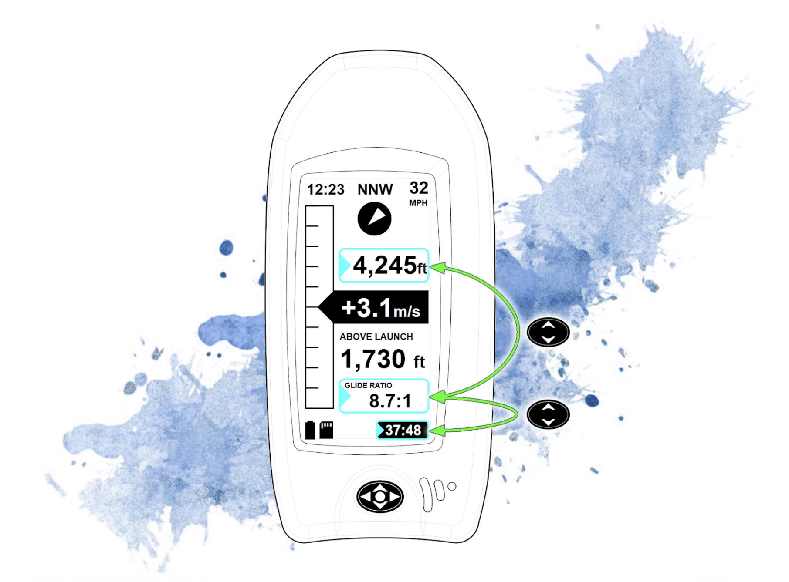

import "./style.css"
import ManualContactLinks from "../../../website/src/components/manual-contact-links.astro"
import LeafLogStatusIcon from "./LeafLogStatusIcon.astro"
import NavMetricTable from "./NavMetricTable.astro"
import LcdScreenshot from "./LcdScreenshot.astro"
import RouteGuidanceDiagram from "./RouteGuidanceDiagram.astro"
import ChargingStatusTable from "./ChargingStatusTable.astro"
import navigateCurrent from "./release-screens/navigate.png"
import leafLogotype from "./leaf-logotype.png"
import leafGreenBg from "./leaf-green-bg.png"
import button from "./button.png"
import buttonCenter from "./button-center.png"
import buttonLeftRight from "./button-left-right.png"
import buttonLeftOnly from "./button-left-only.png"
import buttonUpDown from "./button-up-down.png"
import cursorBox from "./cursor-box.png"
import leafPages from "./leaf-pages.png"
import navDestination from "./release-screens/nav-destination.png"
import userPage from "./user-page.png"
import thermalCorePage from "./release-screens/thermal-core.png"
import thermalTrackPage from "./release-screens/thermal-track.png"
import mainMenu from "./menu_images/MainMenu.png"
import flightMenu from "./menu_images/FlightNoSyncAlt.png"
import settingsMenu from "./menu_images/Settings.png"
import varioMenu from "./menu_images/Vario.png"
import altimeterMenu from "./menu_images/Altimeter.png"
import displayMenu from "./menu_images/Display.png"
import leafLabsMenu from "./menu_images/LeafLabs.png"
import unitsMenu from "./menu_images/Units.png"
import loggingMenu from "./release-screens/logging-menu.png"
import connectMenu from "./menu_images/Connect.png"
import systemMenu from "./menu_images/System.png"
import navDataMenu from "./menu_images/NavData.png"
import gpsMenu from "./menu_images/GPS.png"
import webAppMenu from "./menu_images/WebApp.png"
import logbookMenu from "./menu_images/Logbook.png"
import wifiSetupLeafScreenshot from "./menu_images/WifiSetup_leafScreenshot.png"
import wifiPortalScreenshot from "./menu_images/WifiPortal_screenshot.png"
import webAppMainPage from "../../../website/public/photos/web-app/png_screenshots/WebApp_screenshots_1_mainPage.png"
import webAppProfiles from "../../../website/public/photos/web-app/png_screenshots/WebApp_screenshots_2_profiles.png"
import webAppLogbook from "../../../website/public/photos/web-app/png_screenshots/WebApp_screenshots_3_logbook.png"
import webAppWaypointsRoutes from "../../../website/public/photos/web-app/png_screenshots/WebApp_screenshots_4_waypointsRoutes.png"
import webAppCreateRoute from "../../../website/public/photos/web-app/png_screenshots/WebApp_screenshots_5_createRoute.png"
import webAppVarioSettings from "../../../website/public/photos/web-app/png_screenshots/WebApp_screenshots_6_varioSettings.png"
import webAppVarioTones from "../../../website/public/photos/web-app/png_screenshots/WebApp_screenshots_7_varioTones.png"
import ResetButton from "./ResetButton.png"

  

  

# Quick Start Guide

## Getting Around

Meet the Directional Pad:

<table className="button-table">
  <thead>
    <tr>
      <th></th>
      <th></th>
    </tr>
  </thead>
  <tbody>
    <tr>
      <td></td>
      <td>You control the Leaf with this 5-way switch by pressing  UP, DOWN, LEFT, RIGHT, and CENTER</td>
    </tr>
    <tr>
      <td></td>
      <td>Turn Leaf ON and OFF by holding CENTER</td>
    </tr>
    <tr>
      <td></td>
      <td>Use LEFT and RIGHT to scroll through the pages</td>
    </tr>
  </tbody>
</table>

All the way to the right you'll find the MENU page:

  

<table className="button-table">
  <thead>
    <tr>
      <th></th>
      <th></th>
    </tr>
  </thead>
  <tbody>
    <tr>
      <td></td>
      <td>Within a page, use UP and DOWN to scroll through the options</td>
    </tr>
    <tr>
      <td></td>
      <td>A cursor box highlights the selected field or menu option. Use <strong>UP</strong> or <strong>DOWN</strong> to move it, then press <strong>CENTER</strong> to select or change the item. The cursor box disappears after about five seconds without a button press.</td>
    </tr>
    <tr>
      <td></td>
      <td>Press <strong>CENTER</strong> to open the highlighted option or change its value.</td>
    </tr>
  </tbody>
</table>

  <h3>Examples</h3>
  
<strong>Manually starting and stopping the flight timer:</strong>

  <ul>
    <li>Press <strong>UP</strong> to select the timer. Press <strong>CENTER</strong> to start the timer.</li>
    <li>If the timer is running, press <strong>UP</strong> to select the timer, then hold <strong>CENTER</strong> for a few seconds to stop the timer.</li>
  </ul>
  
<strong>Switching between GPS and Pressure Altitude:</strong>

  <ul>
    <li>Press <strong>UP</strong> or <strong>DOWN</strong> as needed to select the altitude field. Press <strong>CENTER</strong> to switch between GPS and Pressure Altitude.</li>
  </ul>

  
  
The selection cursor wraps around from top to bottom. When nothing is selected on a page or menu, press <strong>DOWN</strong> to reach items near the top faster, or press <strong>UP</strong> to reach items near the bottom faster.

<table className="button-table">
  <thead>
    <tr>
      <th></th>
      <th></th>
    </tr>
  </thead>
  <tbody>
    <tr>
      <td></td>
      <td>
        In a few cases, you can use <strong>LEFT</strong> and <strong>RIGHT</strong> on an option as well. For example:
        <ul>
          <li><strong>Altitude Field:</strong> Adjust the barometric altimeter pressure setting</li>
          <li><strong>Nav Page destination field:</strong> Scroll through waypoints and routes</li>
        </ul>
      </td>
    </tr>
  </tbody>
</table>

  
  
<strong>Shortcut:</strong> Select MSL Altitude (height above sea level), then hold <strong>CENTER</strong> to set the pressure altimeter to match GPS altitude.  This is useful when you don’t know the site altitude or local pressure setting. (This shortcut requires a GPS fix)

## User Page

The User Page shows your main flight information. You can choose what appears in the two customizable fields: select either field with <strong>UP</strong> or <strong>DOWN</strong>, then press <strong>CENTER</strong> to cycle through the options.

  

*Blue are fields that can be adjusted; Green is fixed information*

<h2 id="thermal-pages">Thermal Pages</h2>

  <LcdScreenshot image={thermalCorePage} alt="Current Thermal Core screen with climb history, minute-average climb, breadcrumbs and centering guidance" />
  

    <ul>
      <li>
        
<strong>Thermal Core</strong> shows your recent flight path as dots. Larger dots mark stronger lift. As you circle, Leaf estimates the thermal’s center and marks it with a target circle to help you center your turns.

        <ul>
          <li><strong>Climb history</strong>: The small graph above the map shows about three minutes of altitude history. Use this graph to determine if a thermal is weakening or if you're reaching the top of lift.</li>
          <li><strong>Minute average</strong>: The number beside the graph shows your average climb or sink over the last minute, helping you judge the thermal’s overall strength.</li>
          <li><strong>Wind</strong>: When Leaf has estimated the wind, it shows a wind indicator and adds a small wind arrow in the center of the thermal circle to help you account for drift.</li>
        </ul>
      </li>
    </ul>
  

  <LcdScreenshot image={thermalTrackPage} alt="Current Thermal Track screen showing saved thermals and selected-thermal distance and strength" />
  

    <ul>
      <li>
        
<strong>Thermal Track</strong> shows where you found lift earlier in this flight, with positions adjusted for wind drift and altitude. Darker dots mark thermals Leaf considers more promising at your current altitude.

        <ul>
          <li>Fly toward a thermal dot to select it. Leaf shows its distance and strength, with arrows beside the distance to guide you left or right.</li>
          <li>These dots show previous lift; the thermal may have moved or faded.</li>
        </ul>
      </li>
    </ul>
  

## Nav Page

  <LcdScreenshot image={navigateCurrent} alt="Current Navigate screen with cylinder and goal distances and predicted arrival heights" />
  

    
The Nav Page guides you to a waypoint or along a route. Follow the solid arrow in the compass circle. Below it are your current destination, a progress bar, and four fields you can customize.

    
For more details on using and configuring the Nav Page, please see the <a href="#navigation">Navigation section</a> of the manual.

  

<section className="manual-first-flight">
  <h2 id="before-your-first-flight">Before Your First Flight</h2>

- Fully charge Leaf using a USB-C cable.
- Read the liability waiver included with Leaf. Leaf will ask you to accept it the first time you turn it on. You can disable this reminder later in <strong>Menu &rarr; Settings &rarr; System</strong>.
- Under Main Menu → Settings, turn on Vario → Quiet Mode to keep Leaf quiet until your flight starts, and <strong>Logging → AutoStart</strong> to start the flight timer automatically at launch. Set your local time zone under System.
- You may wish to <a href="#firmware-updates">update to the latest firmware</a>.
- Mount Leaf using the Velcro strap or base plate, and always attach the lanyard.
- Test Leaf on the ground before flying.

<strong>First GPS fix:</strong> Leaf may take 10-15 minutes to acquire its first GPS fix. Place it outside with a clear view of the sky. Subsequent fixes should be faster after initial satellite data is saved.

 

<strong>Stay connected:</strong> We love hearing feedback, ideas, and flight experiences. Chat with us on <a href="https://discord.gg/m7nC8Dgbu6">Discord</a> or <a href="mailto:leafvario@gmail.com">Email</a>.

 

Thank you for supporting open-source flight instruments.

Fly safe and enjoy the adventure!

</section>

# Menu Options

The Leaf menu is the last main page. Scroll <strong>&rarr;</strong> right through the pages to open it. When you enter the menu, Leaf will try to auto-connect to any known saved WiFi networks. You will see the connection status at the top.

  
  
<strong>Shortcut:</strong> To quickly exit the menu, press <strong>LEFT</strong> on most menu options to go back or exit.

## Main Menu

  <LcdScreenshot image={mainMenu} alt="Main Menu" />
  

    <ul>
      <li><strong>WiFi Status</strong>: Leaf will show network name and connection status.</li>
      <li><strong>Flight</strong>: Quick-access settings you may wish to change just before or during a flight.</li>
      <li><strong>Settings</strong>: Adjust settings and preferences, and enable or disable features.</li>
      <li><strong>Nav Data</strong>: Select waypoint and route files for navigation.</li>
      <li><strong>GPS</strong>: View GPS fix quality, satellite positions, and current coordinates.</li>
      <li><strong>Web App</strong>: Open the Leaf Web App on a phone or computer.</li>
      <li><strong>Logbook</strong>: Review saved flight summaries.</li>
    </ul>
  

### Flight Page

  <LcdScreenshot image={flightMenu} alt="Flight Page" />
  

    <ul>
      <li><strong>Profiles</strong>: Select the active pilot and glider profiles to save in the logbook.</li>
      <li><strong>VarioVol</strong>: Adjust the volume of the vario beeps.</li>
      <li><strong>Save Point</strong>: Save your current location to user waypoints and, if recording, mark a point of interest in the IGC log file.</li>
    </ul>
    
<strong>Navigation options:</strong> The following options are only shown if Leaf is currently navigating, or was previously navigating, to a waypoint or route.

    <ul>
      <li><strong>Resume Rte / Resume Pt</strong>: Resume navigation to the previous route or waypoint.</li>
      <li><strong>Reset Rte / Restart Rte</strong>: Start the active or previous route again from the first waypoint.</li>
      <li><strong>Cancel Nav</strong>: Stop actively navigating to the current waypoint.</li>
    </ul>
  

### Settings Menu

Below is an overview of available Leaf settings. For full descriptions of each one, please see the <a href="#settings-submenus">Settings Submenus</a> section further below.

  <LcdScreenshot image={settingsMenu} alt="Settings Menu" />
  

    <ul>
      <li><strong>Vario</strong>: Adjust audio feedback and climb/sink thresholds.</li>
      <li><strong>Altimeter</strong>: Sync or adjust barometric altitude.</li>
      <li><strong>Display</strong>: Choose visible pages and tune screen contrast.</li>
      <li><strong>Units</strong>: Choose altitude, speed, distance, temperature, and time units.</li>
      <li><strong>Logging</strong>: Configure IGC logging and automatic start/stop behavior.</li>
      <li><strong>Connect</strong>: Configure WiFi and Bluetooth features.</li>
      <li><strong>Leaf Labs</strong>: Explore and enable new features that are still in development.</li>
      <li><strong>System</strong>: Set time zone, volume, auto-off, firmware updates, and reset options.</li>
    </ul>
  

### Nav Data Page

  <LcdScreenshot image={navDataMenu} alt="Nav Data Page" />
  

    <ul>
      <li><strong>Active Point/Route</strong>: Shows the current navigation destination.</li>
      <li><strong>Active File</strong>: Shows the waypoint or route file currently loaded.</li>
      <li><strong>Pts / Rtes</strong>: Shows how many points and routes were found in the loaded file.</li>
      <li><strong>Navigate To</strong>: Opens the list of available destinations.</li>
      <li><strong>Load File</strong>: Loads a waypoint or route file from the SD card.</li>
      <li><strong>Clear All</strong>: Unloads the current navigation data without deleting files from the SD card.</li>
    </ul>
  

### GPS Menu

  <LcdScreenshot image={gpsMenu} alt="GPS Menu" />
  

    <ul>
      <li><strong>Status icon</strong>: Shows a solid dot when Leaf has a GPS fix. Otherwise, it blinks and shows the current satellite count while searching for a fix.</li>
      <li><strong>Sats</strong>: Shows how many satellites are used in the current fix.</li>
      <li><strong>HDOP</strong>: Shows fix quality. Lower is better; below 2 is generally good.</li>
      <li><strong>Sky view</strong>: Shows satellite positions in the sky, with north at the top. The center of the circle is directly overhead.</li>
      <li><strong>Lat / Lon</strong>: Shows current GPS coordinates.</li>
      <li><strong>Update(sec)</strong>: Shows how often the GPS position is updated. This is currently fixed at 1 second. In the future we may allow slower update cycles for battery savings.</li>
    </ul>
  

### Web App Page

  <LcdScreenshot image={webAppMenu} alt="Web App Page" />
  

    <ul>
      <li><strong>Connected to</strong>: Shows the WiFi network Leaf is using.</li>
      <li><strong>QR code</strong>: Scan with a phone to open the Leaf Web App.</li>
      <li><strong>Address</strong>: Type the shown address into a browser if you are not using the QR code.</li>
      <li><strong>Use Leaf AP</strong>: Switches to Leaf's own WiFi network when you are away from saved WiFi.</li>
    </ul>
    
If Leaf is not connected to a saved WiFi network, it creates its own network. Join the Leaf network on your phone or computer, then scan the QR code or open the address shown on Leaf.

  

### Logbook Page

  <LcdScreenshot image={logbookMenu} alt="Logbook Page" />
  

    <ul>
      <li><strong>Flight Summary</strong>: Shows the date, time, and duration of the flight.</li>
      <li><strong>Flight Metrics</strong>:</li>
    </ul>
    

      
- Max altitude, climb, and sink

      
- Distance between start and end points

      
- Distance flown along the flight path

      
- Max groundspeed

      
- Min and max acceleration (g force)

      
- Max observed wind speed, if an estimate was captured during the flight

    

    <ul>
      <li><strong>Delete</strong>: Erases the log summary as well as any recorded IGC flight track.</li>
      <li><strong>Page Number / Total</strong>: Scroll LEFT and RIGHT through all logbook entries.</li>
    </ul>
  

## Settings Submenus

### Vario Settings

  <LcdScreenshot image={varioMenu} alt="Vario Settings" />
  

    <ul>
      <li><strong>Beep Volume</strong>: Sets the climb and sink audio volume.</li>
      <li><strong>Vol Shortcut</strong>: When enabled, hold UP or DOWN on a flight page to temporarily adjust vario volume without changing the saved Beep Volume setting.</li>
      <li><strong>Quiet Mode</strong>: Keeps vario beeps silent until the flight timer starts.</li>
      <li><strong>Sensitivity</strong>: Controls how quickly the vario responds. Higher values feel more immediate.</li>
      <li><strong>ClimbStart</strong>: Sets the climb rate needed before climb beeps begin.</li>
      <li><strong>SinkAlarm</strong>: Sets the descent rate needed before the sink alarm sounds. Select <strong>OFF</strong> to disable sink audio.</li>
      <li><strong>Climb Avg</strong>: Smooths the displayed climb-rate number over up to 20 seconds. Longer averaging makes the number steadier but slower to change. The vario bar and beeps respond as usual.</li>
      <li><strong>Glide Avg</strong>: Smooths the displayed glide ratio over up to <strong>20 seconds</strong>. Longer averaging makes the number steadier but slower to change.</li>
    </ul>
  

### Altimeter Settings

  <LcdScreenshot image={altimeterMenu} alt="Altimeter Settings" />
  

    <ul>
      <li><strong>GPS Alt</strong>: Shows current GPS altitude when Leaf has a GPS fix.</li>
      <li><strong>Sync Now</strong>: Immediately sets the barometric altitude equal to GPS altitude.</li>
      <li><strong>@LogStart</strong>: Sets the pressure altimeter to match GPS altitude when flight recording begins.</li>
      <li><strong>Baro (Std)</strong>: Altitude MSL using the 29.92 inHg standard pressure setting.</li>
      <li><strong>Baro (Adj)</strong>: Altitude MSL using the current pressure setting.</li>
      <li><strong>Set</strong>: Current pressure setting value.</li>
      <li><strong>Adjust Alt</strong>: Press or hold <strong>LEFT</strong> or <strong>RIGHT</strong> until the displayed altitude matches your known altitude.</li>
    </ul>
  

### Display Settings

  <LcdScreenshot image={displayMenu} alt="Display Settings, including Thermal Core Auto Switch" />
  

    <ul>
      <li><strong>Show Pages</strong>: Choose which flight pages are enabled. At least one must remain selected.</li>
      <li className="manual-subnote"><strong>Basic</strong>: Simplified vario page with the largest font.</li>
      <li className="manual-subnote"><strong>User</strong>: Vario page with 2 configurable user fields.</li>
      <li className="manual-subnote"><strong>Thermal Core</strong>: Shows lift strength and turn guidance to help center around a thermal core.</li>
      <li className="manual-subnote"><strong>Auto Switch?</strong>: When enabled, automatically switches to the Thermal Core page when circling in lift, then returns to your previous page once you’ve left the thermal.</li>
      <li className="manual-subnote"><strong>Thermal Track</strong>: Maps previous thermals from earlier in your flight to help you find them again when needed.</li>
      <li className="manual-subnote"><strong>Navigate</strong>: Select and navigate to waypoints and along routes. Has 4 customizable fields.</li>
      <li><strong>Contrast</strong>: Adjusts the screen contrast for current lighting and temperature.</li>
    </ul>
  

### Units Settings

  <LcdScreenshot image={unitsMenu} alt="Units Settings" />
  

    <ul>
      <li><strong>Altitude</strong>: Feet or meters.</li>
      <li><strong>ClimbRate</strong>: Feet per minute or meters per second.</li>
      <li><strong>Speed</strong>: Miles per hour or kilometers per hour.</li>
      <li><strong>Distance</strong>: Miles/kilometers, with shorter distances shown in feet/meters.</li>
      <li><strong>Heading</strong>: Compass directions or degrees from north.</li>
      <li><strong>Temp</strong>: Fahrenheit or Celsius.</li>
      <li><strong>Time</strong>: 12-hour or 24-hour time.</li>
    </ul>
  

### Logging Settings

  <LcdScreenshot image={loggingMenu} alt="Logging Settings" />
  

    <ul>
      <li><strong>Save IGC</strong>: Saves an IGC track file while the flight timer is running and GPS has a fix.</li>
      <li><strong>AutoStart</strong>: Monitors speed and altitude changes to detect launch and auto-start the timer and flight log.</li>
      <li><strong>AutoStop</strong>: Stops the flight timer when Leaf detects you have landed. A warning appears first; press any button to keep recording.</li>
      <li><strong>Repair Logs</strong>: Checks for interrupted logbook saves and repairs recoverable entries. Stop the flight timer first. See <a href="#repairing-the-logbook"><strong>Repairing the Logbook</strong></a>.</li>
    </ul>
  

### Connect Settings

  <LcdScreenshot image={connectMenu} alt="Connect Settings" />
  

    <ul>
      <li><strong>WiFi Setup</strong>: Creates the Leaf setup network so you can save WiFi credentials.</li>
      <li className="manual-subnote">See <a href="#connect-to-wifi">Connect to WiFi</a> for more details.</li>
      <li><strong>WiFi Reset</strong>: Clears saved WiFi networks.</li>
      <li><strong>BLE</strong>: Enables Bluetooth Low Energy for sharing flight data with compatible apps.</li>
      <li><strong>Name</strong>: Shows the Bluetooth device name advertised by Leaf.</li>
    </ul>
  

### System Settings

  <LcdScreenshot image={systemMenu} alt="System Settings" />
  

    <ul>
      <li><strong>Time Zone</strong>: Sets local time for the clock and flight logs. Press <strong>CENTER</strong> to switch between one-hour and 15-minute adjustments.</li>
      <li><strong>Volume</strong>: Sets system alert, button, and notification volume.</li>
      <li><strong>Auto-Off</strong>: Turns Leaf off after inactivity when no log is running.</li>
      <li><strong>ShowSafety</strong>: Shows or hides the startup safety disclaimer.</li>
      <li><strong>About</strong>: Shows firmware and device information.</li>
      <li><strong>Update FW</strong>: Checks for and installs firmware updates over WiFi.</li>
      <li><strong>Reset</strong>: Hold CENTER to reset Leaf settings without erasing the SD card or flight logs.</li>
    </ul>
  

# SD Card & Logging

### Accessing the SD card

Turn Leaf off and connect it to your computer or phone with a USB cable. Open the LEAF VARIO drive to access the SD card.

If Leaf Log is uploading flights, wait for uploads to finish or press <strong>CENTER</strong> twice to cancel them and open the drive.

 

Leaf charges over USB whether it is on or off, but the USB drive is available only while Leaf is off. Safely eject the drive before unplugging Leaf or turning it on.

<h3 id="saving-track-logs">Saving Track Logs</h3>

To save your flight path as an IGC track file, turn on <strong>Main Menu → Settings → Logging → Save IGC</strong>. Recording begins when the flight timer is running and Leaf has a GPS fix. After landing, stop the timer manually or let AutoStop stop it for you.

  
  
<strong>Shortcut:</strong> You can simply hold the center button at the end of a flight to turn off Leaf, even while the timer is running. While shutting down, Leaf will end the log and save the track file. Leaf will also save a running log if the battery runs out while recording.

Short recordings may show dashes for some flight statistics.

<h3 id="repairing-the-logbook">Repairing the Logbook</h3>

If the Logbook shows <strong>Repair needed</strong>, stop the flight timer and back up important SD card files to your computer. With the SD card in Leaf, open <strong>Settings → Logging → Repair Logs</strong> and follow the result shown on screen. Press <strong>LEFT</strong> or <strong>CENTER</strong> to cancel.

Repair Logs can recover interrupted flight summaries, but cannot restore a deleted track file.

### Files and Folders

Leaf will create folders and files on the SD card as you use different features:

<ul className="manual-folder-list">
  <li><strong>tracks/</strong> Stores recorded IGC flight track files.</li>
  <li><strong>logbook/</strong> Stores the flight summaries shown in Leaf’s Logbook and Web App.</li>
  <li><strong>waypoints/</strong> Stores waypoint files for navigation. Copy <strong>GPX</strong>, <strong>CUP</strong>, <strong>WPT</strong>, or <strong>WYP</strong> files here. User waypoints saved on Leaf are also stored in this folder.</li>
  <li><strong>routes/</strong> Stores saved routes.</li>
  <li><strong>profiles/</strong> Stores pilot and glider profiles saved through the Web App.</li>
  <li><strong>firmware/</strong> Stores firmware files and update status messages for <a href="#flash-firmware-via-the-sd-card">manual firmware updates via the SD card</a>.</li>
  <li><strong>diagnostics/</strong> May appear when diagnostic features are enabled or troubleshooting information is saved.</li>
</ul>

# Navigation

<h2 id="waypoints-and-routes">Waypoints and Routes</h2>

Leaf can load waypoint and route files from the SD card. Save waypoint files in the <strong>waypoints</strong> folder on the “LEAF VARIO” drive, or import a waypoint file from your phone using the <a href="#loading-waypoints">Web App</a>. Leaf accepts <strong>GPX</strong>, <strong>CUP</strong>, <strong>WPT</strong>, and <strong>WYP</strong> files. GPX files may contain waypoints, routes, or both.

### Loading and Activating Files

On Leaf, open <strong>Main Menu &rarr; Nav Data &rarr; Load File</strong>, then choose the file you want to use.

  
The Nav Data page shows the loaded file and the number of waypoints and routes it contains. Choose <strong>Navigate To</strong> to select your destination. If you load a saved route from the routes folder, navigation starts automatically.

  
File limits: Up to <strong>20 points</strong> per route and <strong>120 waypoints</strong> per loaded file. A GPX file can load up to 10 routes with 80 route points in total; a point used in two routes counts twice. Files over the point limits will not load, and only the first 10 routes are loaded.

  
Loading another file replaces the waypoints and routes currently in use. <strong>Clear All</strong> stops navigation and unloads them. Neither action deletes your saved files.

### Selecting a Route or Point

Open <strong>Main Menu &rarr; Nav Data &rarr; Navigate To</strong> to choose a waypoint or route from the loaded file.

Leaf shows your destination under <strong>Active Point/Route</strong>. Each route point has a circular area around it, called a cylinder. If no cylinder radius is defined, Leaf uses 400 m. With the flight timer running, Leaf uses GPS to detect when you enter the cylinder and automatically guides you to the next point. To skip a point or go back, use the destination-field shortcut below.

 

When you select a route from a GPX file, or create or import a route from the Leaf Web App, Leaf automatically creates and saves a route file in the <strong>routes</strong> folder on the SD card. Saved routes can be loaded again later from <strong>Main Menu &rarr; Nav Data &rarr; Load File</strong>.

### Quick Access

  

    <LcdScreenshot image={flightMenu} alt="Flight menu shortcut" />
    
<strong>Shortcut:</strong> Open <strong>Main Menu &rarr; Flight</strong> to resume, reset, or cancel navigation without going back through the Nav Data menu.

  

  

    <LcdScreenshot image={navDestination} alt="Actual Nav Page destination strip showing the active RIDGE waypoint" />
    
<strong>Shortcut:</strong> On the Nav Page, scroll up to the destination field, then press <strong>LEFT</strong> or <strong>RIGHT</strong> to move through available navigation points. Press <strong>CENTER</strong> to select one as the new destination. This is especially useful while navigating a route if you want to skip ahead or go back to a previous point.

  

<h2 id="using-and-configuring-the-nav-page">Using the Nav Page</h2>

  <LcdScreenshot image={navigateCurrent} alt="Current Navigate screen with cylinder and goal distances and predicted arrival heights" />
  

    
To follow Leaf’s guidance, steer until the solid arrow points to the top of the compass circle. The smaller hollow arrow shows the direction of the following waypoint, helping you anticipate the next turn. The progress bar below the waypoint name fills as you approach its cylinder.

    
The four lower navigation fields are independently configurable. Select a field with the cursor then press <strong>CENTER</strong> to cycle through the choices below. Your choices are saved.

    
The filled diamond <strong>◆</strong> means the waypoint center; the ring  means cylinder entry. <strong>GOAL</strong> is the final cylinder of the route. When navigating to a single standalone waypoint, that point is also the goal, with a default 400 m cylinder.

  

<NavMetricTable />

  <h2 id="optimized-route-guidance">Optimized Route Guidance</h2>
  
Leaf guides you along a shorter path through the remaining waypoint cylinders, updating the route as you fly.

  
On a glancing approach, Leaf aims up to 20m inside the cylinder to make entry more forgiving and to help record an IGC track point inside the cylinder. Entering the cylinder advances the route; there is no need to actually reach the inward aiming point.

<RouteGuidanceDiagram />

Leaf does not yet support timed starts, speed sections, or line goals. When it cannot optimize a route, it guides you toward the waypoint centers.

# Connect to WiFi

Connect Leaf to a local WiFi network for firmware updates, log uploads, and easier access to the Leaf Web App. To connect, start the setup process on Leaf, then finish connecting on your phone, as shown below.

  📶
  
Leaf requires a <strong>2.4 GHz WiFi network</strong>. It is not compatible with 5 GHz-only networks. If your router uses separate network names for each frequency, select the 2.4 GHz network.

### Start WiFi setup on Leaf

  
  

    <ul>
      <li>On Leaf, open <strong>Main Menu &rarr; Settings &rarr; Connect &rarr; WiFi Setup</strong>.</li>
      <li>Leaf will create its own temporary WiFi network named Leaf followed by four characters, similar to Leaf-AB12.</li>
      <li>Leave Leaf on the setup screen while you use a phone, tablet, or computer to finish the setup.</li>
    </ul>
  

### Save your network from a phone or computer

  
  

    <ol>
      <li>Open WiFi settings on your phone or computer and join the Leaf network shown on the Leaf screen, using the password shown on Leaf.</li>
      <li>The Leaf setup page should open automatically. If it does not, tap the "Sign in to Leaf WiFi" prompt or visit <a href="http://192.168.4.1">192.168.4.1</a>.</li>
      <li>Select your WiFi network from the list, or type the network name manually.</li>
      <li>Enter the password carefully. Network names and passwords are case-sensitive.</li>
      <li>Save the settings. Leaf will leave setup mode and try to connect to the saved network.</li>
    </ol>
  

After a successful connection, Leaf will save that network and try to reconnect automatically every time you open the Leaf menu. Leaf will save up to three of your last-used networks. You may wish to save your phone's hotspot network into Leaf as well, so you can use WiFi features out in the field.

 

You can open the Leaf Web App from a phone or computer on the same WiFi network. Internet access is needed for firmware updates and Leaf Log uploads.

### Connecting to a Phone Hotspot

If a WiFi network is not currently available, but you need to use internet-required features on Leaf such as checking for firmware updates or uploading logs, you can connect Leaf to your phone's hotspot.

 

Remember that for local Leaf Web App functions, like editing waypoints/routes and viewing your logbook, you do not need internet or a hotspot. You can have your phone connect to Leaf directly.

 

<ol>
  <li>Turn on your phone’s WiFi hotspot and note its network name and password.</li>
  <li>Follow <a href="#connect-to-wifi">Connect to WiFi</a> to open Leaf’s WiFi setup page. Enter your hotspot’s name and password, typing the name manually if needed.</li>
  <li>Choose <strong>Save and Connect</strong>, then turn your hotspot back on if joining Leaf’s network switched it off.</li>
</ol>

Next time, just turn on the hotspot before opening Leaf’s Main Menu. (When the Main Menu page opens, Leaf will automatically try connecting to the last 3 used networks, including your hotspot).

If setup is difficult, use a second device as described in the iPhone note below.

  
<strong>iPhone hotspot note:</strong> Connecting Leaf to an iPhone hotspot may require another device, such as a tablet, laptop, or a friend's phone. Turn on your iPhone hotspot and set it aside, then use the other device to follow the <a href="#connect-to-wifi"><strong>Connect to WiFi</strong></a> steps and select the iPhone hotspot as the network Leaf should join.

### WiFi Troubleshooting

Having issues connecting Leaf to WiFi networks? You can try the following:

Try these steps in order:

<ol>
  <li>Exit and reopen the Main Menu to retry the connection.</li>
  <li>Check that the network supports 2.4 GHz and that its name and password are correct. Leaf remembers only three networks, so you may need to add an older one again.</li>
  <li>Unplug Leaf from USB power, then turn it off and on again.</li>
  <li>If it still will not connect, select <strong>Settings → Connect → WiFi Reset</strong> and repeat WiFi Setup. WiFi Reset erases all saved networks.</li>
</ol>

# Leaf Web App

Use the Leaf Web App in your phone, tablet, or computer’s browser to adjust vario settings, manage profiles, review flights, and create routes. It runs on Leaf, so these features work without internet access.

### Opening the Web App

  
  

    <ol>
      <li>On Leaf, open <strong>Main Menu → Web App</strong>.</li>
      <li>Connect your phone or computer to the same WiFi network as Leaf. If Leaf is using its own network, join the Leaf network shown on its screen.</li>
      <li>Scan Leaf’s QR code or type the displayed address into your browser.</li>
    </ol>
     
    
The first page of the Web App gives you a quick overview of Leaf:

    <ul>
      <li><strong>Leaf status</strong>: Check battery, WiFi, firmware, and hardware information. Firmware updates require a network with internet access.</li>
      <li><strong>Settings gear</strong>: Open the vario settings.</li>
      <li><strong>Profiles</strong>: Quickly select the active pilot and glider.</li>
      <li><strong>Logbook</strong>: See a summary of recent saved flights.</li>
      <li><strong>Navigation</strong>: See the waypoint file, points, and routes currently loaded.</li>
      <li><strong>Leaf Log</strong>: When enabled in Leaf Labs, pair this Leaf with a Leaf Log account.</li>
    </ul>
  

### Profiles

  
  

    <ul>
      <li>Open <strong>Profiles</strong> to save pilot and glider details.</li>
      <li>Choose which pilot and glider are active before a flight.</li>
      <li>Selected pilot and glider details are included in the logbook and recorded in the IGC flight track file.</li>
    </ul>
  

### Logbook

  
  

    <ul>
      <li>Open <strong>Logbook</strong> to review saved flight summaries.</li>
      <li>Flight summaries include time, duration, altitude, vario, distance, speed, acceleration, and observed wind information when available.</li>
      <li>When Leaf Log is enabled, an icon beside each IGC track shows whether it was uploaded, is still pending, or was rejected.</li>
      <li>Open a flight’s track preview to see its recorded path.</li>
      <li>Deleting a logbook entry from the Web App also deletes the recorded IGC track file for that flight.</li>
    </ul>
  

### Loading Waypoints

  
  

    <ul>
      <li>Click <strong>Import New File</strong> to select a file from your phone, tablet, or computer, then upload and save it to Leaf.</li>
      <li>Select a saved waypoint file from the dropdown, then choose <strong>Activate File</strong> to load it for on-device navigation.</li>
      <li>Navigate directly to a saved point or open a point on a map.</li>
      <li>Rename saved user waypoints or delete points you no longer need. User waypoints are created on Leaf from <strong>Main Menu &rarr; Flight &rarr; Save Point</strong>.</li>
    </ul>
  

### Creating and Importing Routes

  
  

    <ul>
      <li>You can create your own routes using waypoints from the loaded file.</li>
      <li className="manual-subnote manual-markerless manual-tight-subitem">- Select a waypoint and enter its cylinder radius. Click <strong>Add Point</strong>, then repeat for the remaining waypoints.</li>
      <li className="manual-subnote manual-markerless manual-tight-subitem">- Once complete, give the route a name and click <strong>Save Route</strong>.</li>
      <li className="manual-subnote manual-markerless manual-tight-subitem">- Leaf will save this route in the <strong>routes</strong> folder on the SD card.</li>
      <li className="manual-subnote manual-markerless manual-tight-subitem manual-subgroup-end">- If you checked the <strong>Set as active</strong> box, Leaf will activate this route immediately.</li>
      <li>Leaf can import routes from QR code data, which is common at paragliding events and competitions.</li>
      <li className="manual-subnote manual-markerless manual-tight-subitem">- Use your phone's camera app or photo gallery lens feature to extract the text from the QR code.</li>
      <li className="manual-subnote manual-markerless manual-tight-subitem">- Paste the text into the <strong>Task / Route Data</strong> field.</li>
      <li className="manual-subnote manual-markerless manual-tight-subitem">- If desired, check the <strong>Set as active route</strong> box.</li>
      <li className="manual-subnote manual-markerless manual-tight-subitem">- Give the route a name, then click <strong>Save to Leaf</strong>.</li>
    </ul>
    
<strong>WARNING:</strong> Common messaging apps often remove or reformat certain punctuation marks, so be careful when sending or receiving “task text” through chat apps. It is more reliable to get the text straight from the QR code.

  

<h3 id="web-app-vario-settings">Web App Vario Settings</h3>

  
  

    <ul>
      <li>Tap the <strong>settings gear</strong> beside the battery on the main page.</li>
      <li><strong>General</strong>: Adjust beep volume, sensitivity, quiet mode, the volume shortcut, and climb/glide averaging.</li>
      <li>Click <strong>Save to Leaf</strong> in each section to apply your changes.</li>
      <li><strong>Defaults</strong> restores that section's standard values; click <strong>Save to Leaf</strong> to apply them.</li>
    </ul>
  

  
  

    <ul>
      <li>Scroll to <strong>Climb</strong> or <strong>Sink</strong> to adjust when beeping starts, tone pitch, beep/pause length, and when the tone becomes continuous.</li>
      <li>Use the <strong>− / +</strong> buttons, type a value, or drag a tone slider. The play button previews an individual tone through Leaf's speaker.</li>
      <li>After saving, click <strong>Test Climb</strong> or <strong>Test Sink</strong> to hear the tones through Leaf while the gauge shows the simulated climb or sink rate. Enable the sink alarm before testing sink tones.</li>
    </ul>
  

# Firmware Updates

Leaf can update to the latest firmware over WiFi. If you have not saved a network yet, follow [Connect to WiFi](#connect-to-wifi) first.

  
<strong>Updating a Leaf running firmware v0.1.7 or earlier?</strong> See <a href="/user-manual/archive/v0-1-7-firmware-updates/">legacy firmware update instructions</a> for the older update process.

 

To check for updates, open <strong>Main Menu &rarr; Settings &rarr; System &rarr; Update FW.</strong> If an update is available, Leaf installs it and restarts when finished. Leaf will display a message if already up to date, and will still need to restart after checking.

 

If Leaf fails to check for updates, restart Leaf and try again.

 

If no WiFi network is available, you can still check for firmware updates using your phone's hotspot and cellular connection. See [Connecting to a Phone Hotspot](#connecting-to-a-phone-hotspot).

### Reloading Firmware Manually

**WARNING** *Manually loading firmware is only for advanced users. For general updates, please use the firmware update process described above.*

**Make sure the firmware file matches your exact Leaf hardware version. Contact us if you are unsure.**

There are two methods for manually loading firmware:
#### Flash firmware via the SD card

Plug Leaf into your computer with a USB cable and leave it off in charging mode. Wait for Leaf Log to finish, or press CENTER twice to confirm cancellation, so the removable drive appears. Copy the new firmware file into the `firmware/` folder on the SD card, safely eject the drive, then unplug Leaf from the USB cable and reboot Leaf. During startup, Leaf will detect the firmware file and attempt to upgrade to the new firmware.

After the upgrade attempt, Leaf will create a status message inside the `firmware/` folder so you can confirm whether the update succeeded or failed. When you are finished, it is okay to delete the firmware file and the status message from the SD card.

#### Flash firmware via USB cable and programming tools

For advanced users who wish to reprogram the firmware manually, the "Boot" button is located behind the smallest speaker hole. To enter bootloader mode, turn Leaf off, then press and hold the Boot button while plugging in the USB cable, then release the Boot button. Or, while already plugged into USB, press and hold the "Boot" button then press and release the "Reset" button, then release the "Boot" button. Once in bootloader mode, the firmware can be uploaded using Arduino, PlatformIO, or Espressif tools.

# Leaf Labs

Leaf Labs is home to experimental features that are ready to try but may continue to change. Open <strong>Main Menu &rarr; Settings &rarr; Leaf Labs</strong> to enable them.

  <LcdScreenshot image={leafLabsMenu} alt="Leaf Labs settings showing the Leaf Log option" />
  

    <ul>
      <li><strong>Leaf Log</strong>: Adds Leaf Log account linking to the Leaf Web App and enables automatic flight uploads while charging.</li>
    </ul>
  

<h2 id="leaf-log">Leaf Log</h2>

Leaf Log is an experimental online flight log. See an example here: [https://log.leafvario.com/flights/806c](https://log.leafvario.com/flights/806c).

 

Link Leaf to your Leaf Log account to upload saved IGC flights automatically while Leaf is off and charging and within range of a saved WiFi network with internet access.

<h3 id="pairing-with-leaf-log">Pairing with Leaf Log</h3>

1. Enable **Main Menu → Settings → Leaf Labs → Leaf Log**.
2. Ensure Leaf is connected to a WiFi network with internet access.
3. Open the [**Leaf Web App**](#leaf-web-app) and in the **Leaf Log** card, choose **Get Activation Code**.
4. Once a code is generated, choose **Open Leaf Log**. Sign in with your email address. If you haven't signed in to Leaf Log before, you may need to receive and open a link emailed to you.
5. Name and link your Leaf to your account.
6. After linking, switch back to the Leaf Web App tab in your browser.

 

Leaf will upload all flights to the linked account regardless of which local pilot profile is selected. Use **Unlink** in the Leaf Web App before lending or transferring the device if you do not want later flights uploaded to your Leaf Log account. You can also revoke a paired vario from the Leaf Log website.

<h3 id="automatic-uploads-while-charging">Automatic uploads while charging</h3>

Turn Leaf off and plug it into USB power near a saved WiFi network with internet access. With Leaf Log enabled and linked to your account, uploads start automatically. The charging screen shows progress. Leaf uploads up to 100 flights each time; any remaining flights wait until the next time you charge.

 

Keep Leaf plugged in and within WiFi range until uploads finish. If the connection fails, Leaf retries automatically. Flights still waiting will be tried again the next time you charge.

 

To open the LEAF VARIO USB drive while uploads are running, press <strong>CENTER</strong>, then press <strong>CENTER</strong> again within five seconds to confirm Cancel Uploads? Flights still waiting will upload the next time you charge.

 

When Leaf Log uploads are enabled, Leaf will show current status on the charging screen:

<ChargingStatusTable />

Both the on-device logbook (<strong>Menu → Logbook</strong>) and the Web App Logbook will show whether each IGC flight was uploaded, is still pending, or was rejected, according to the following symbols:

  

    <LeafLogStatusIcon status="uploaded" />
    
<strong>Filled Leaf — Uploaded:</strong> The flight was successfully uploaded to Leaf Log.

  

  

    <LeafLogStatusIcon status="not-uploaded" />
    
<strong>Hollow Leaf — Not uploaded:</strong> The flight has not been uploaded to Leaf Log yet.

  

  

    <LeafLogStatusIcon status="rejected" />
    
<strong>Error Leaf — Upload rejected:</strong> Leaf Log could not accept the flight. The Web App shows the reason when available.

  

  

    <LeafLogStatusIcon status="none" />
    
No Leaf icon — No IGC track: This entry has no IGC flight recording to upload.

  

# Troubleshooting

Having WiFi connection issues? See [WiFi Troubleshooting](#wifi-troubleshooting) in the Connect to WiFi section.

  <h3 id="sd-card-and-save-problems">SD Card and Save Problems</h3>
  
If Leaf reports that logs are unavailable, check that the SD card is inserted and try opening the Logbook again. If <strong>Repair needed</strong> appears when viewing a flight in Leaf’s on-device Logbook (<strong>Main Menu → Logbook</strong>), stop the flight timer and run <a href="#repairing-the-logbook"><strong>Settings → Logging → Repair Logs</strong></a>. Copy important files off the card before making repairs or replacing the card.

### Restore Factory Defaults
To return all settings to the factory configuration, go to <strong>Menu &rarr; Settings &rarr; System</strong>, then scroll down to the Reset option. Hold the center button to reset all Leaf settings. This will reset Leaf settings and saved WiFi networks, but it will not erase your SD card, logs, pilot or glider profiles, or saved waypoints/routes.

### Hard Reset Leaf
Performing a hard reset is useful if Leaf becomes frozen or unresponsive. The reset button is hidden behind the speaker grille. Press a paperclip or pin into the lower-end of the largest speaker slot to hard reset Leaf. This will force a reboot, but it won't reset your user settings or touch your SD card. After you reset Leaf, you will need to turn it on again if it wasn't plugged into a USB cable at the time.

  

# Contact Us

Have questions, feedback, ideas, or flight stories? We would love to hear from you.

<ManualContactLinks />
